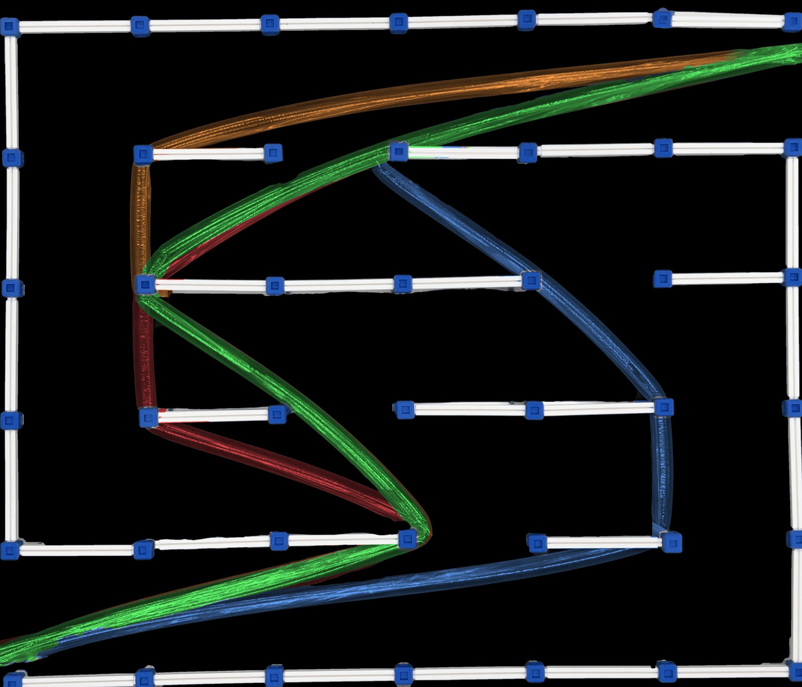

<h1 align="center">VinePlanner</h1>

<p align="center">
  <b>Globally optimal minimum-pressure growth planning for vine robots</b><br>
  Andres C. Torres,
  <a href="https://tobiamarcucci.github.io/">Tobia Marcucci</a>,
  <a href="https://scholar.google.com/citations?user=7rY7A5oAAAAJ">Elliot W. Hawkes</a><br>
  University of California, Santa Barbara
</p>

<p align="center">
  <a href="https://ahsoka.github.io/VinePlanner/"></a>
  <a href="https://arxiv.org/abs/2609.18070"></a>
  <a href="https://www.youtube.com/watch?v=AP7_uw9xASM"></a>
  
  <a href="LICENSE"></a>
</p>

<p align="center">
  
</p>

Vine robots grow from their tip, and the pressure needed to keep growing rises with
every turn they make. If that pressure exceeds the burst pressure, the robot ruptures.
**VinePlanner** finds the path that minimizes growth pressure through an environment
of convex polytopic obstacles:

- **Globally optimal in 2D**, and optimal up to a discretization parameter in 3D
- **Fast:** hundreds of obstacles in tens of milliseconds; 15,000 obstacles in about 21 s
- **Hardware-validated:** the pressure model ranked paths correctly in 100% of trials in both 2D and 3D obstacle courses

> **Why not just take the shortest path?** On a 15,000-obstacle course, the minimum-distance
> path is 4% shorter but turns twice as much (1460° vs. 700°). That pushes its growth
> pressure to **19,430 kPa**, more than 60× the **318 kPa** of the minimum-pressure path.

🌐 **[Try the interactive demo](https://ahsoka.github.io/VinePlanner/)**: place obstacles and compare minimum-pressure and minimum-distance paths live in your browser.

## How it works

1. **Pressure model.** For a piecewise-linear vine robot with segment lengths $l_i$ and turn angles $\theta_i$, tail tension accumulates as

   $$\tau_0^+ = T,\qquad \tau_i^+ = \left(\tau_{i-1}^+ + \lambda l_i\right)e^{\mu\theta_i},\qquad P = Y + \frac{\tau_{n-1}^+ + \lambda l_n}{A}.$$

   Each turn multiplies the tension (the Capstan effect), so total turning dominates over length.
2. **Structure of optimal paths.** There is always an optimal path that is piecewise-linear and bends only at obstacle vertices (2D) or edges (3D). Smooth curving never lowers the pressure.
3. **Graph search.** We build a visibility graph (parallelized with Numba) and an implicit line graph whose edges correspond to turns. Then a label-setting Dijkstra solves the resulting time-dependent shortest-path problem.

## Installation

```bash
pip install git+https://github.com/Ahsoka/VinePlanner.git
```

For 3D voxel courses (adds PyVista for visualization):

```bash
pip install "vine_planner[3d] @ git+https://github.com/Ahsoka/VinePlanner.git"
```

For development:

```bash
git clone https://github.com/Ahsoka/VinePlanner.git
cd VinePlanner
pip install -e .
```

## Quickstart

```python
import numpy as np
from vine_planner.obstacle_course import ObstacleCourse
from vine_planner.path_planner import PathPlanner

def wall(x, y_lo, y_hi, t=0.05):
    return np.array([[x, y_lo], [x + t, y_lo], [x + t, y_hi], [x, y_hi]])

# A small slalom: walls alternate from the bottom and top of a 2 m x 2 m course
walls = [wall(0.5, -0.5, 1.4), wall(1.0, 0.6, 2.5), wall(1.5, -0.5, 1.4)]
course = ObstacleCourse(width=2.0, height=2.0, obstacles=walls)

planner = PathPlanner(course, start=[0.0, 1.0], end=[2.0, 1.0], length_units="m")
paths = planner.compute_all_paths()   # {"distance", "angle", "pressure"}

print(paths["pressure"])              # (k, 2) array of path vertices
print(f"{planner.total_pressure:.2f} psi")

fig, ax = planner.plot()              # course + all three paths
```

A few things to know:

- **`length_units` is a model parameter, not just a display setting.** It sets how heavily length is weighed against turning, so set it to whatever your coordinates actually mean.
- **Pressures are in psi internally.** Plotting functions can display other units.
- **Obstacles must be convex.** Decompose non-convex shapes into convex pieces first.
- **Random courses:** `ObstacleCourse.random(...)` generates random 2D courses, and `ObstacleCourseVoxels` handles 3D voxel courses.
- **First-run slowness:** the first call is slower while Numba compiles its kernels.

## Repository layout

```
vine_planner/
  obstacle_course.py   # 2D polygon courses and 3D voxel courses, visibility kernels
  path_planner.py      # visibility graph, implicit line graph, modified Dijkstra
  constants.py         # fitted pressure-model constants and unit tables
  utils.py             # pressure evaluation and geometry helpers
  tikz.py              # TikZ/pgfplots export used for the paper figures
website/               # project website and the in-browser (Pyodide) demo
```

## Pressure-model constants

Fitted for 1.5" layflat, 2 mil LDPE tubing (Uline S-3521). These are the defaults in `constants.py`:

| Constant | Code (psi) | Paper (SI) |
|---|---|---|
| Yield pressure $Y$ | 0.278 psi | 1.917 kPa |
| Length friction $\lambda/A$ | 0.0341 psi/ft | 0.771 kPa/m |
| Reel tension $T/A$ | 0.787 psi | 5.426 kPa |
| Capstan coefficient $\mu$ | 0.315 | 0.315 |

Only $\mu$ and the ratio $T/\lambda$ affect which path is optimal. $Y$ and $A$ shift the pressure but not the path.

## Citation

```bibtex
@misc{torres2026vineplanner,
  title         = {An Efficient Algorithm for Minimum-Pressure Growth Planning of Vine Robots},
  author        = {Torres, Andres C. and Marcucci, Tobia and Hawkes, Elliot W.},
  year          = {2026},
  eprint        = {2609.18070},
  archivePrefix = {arXiv}
}
```

## Acknowledgments

This work was supported by the Air Force Office of Scientific Research award
FA9550-25-1-0375. We thank Kevin Wu for designing and building the modular
voxel obstacle course used in our hardware experiments.

## License

MIT. See [LICENSE](LICENSE).
